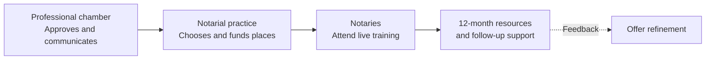

# From Market Gap to Institutional B2B Adoption

**Co-founding, commercializing, and evolving a specialist professional offering in a regulated market**

*An anonymized case study in venture building, founder-led growth, institutional sales, and product development.*

> **My role:** Co-founder | Commercial Development, Marketing & Institutional Relationships  
> **Period:** 2024–2026 (commercial delivery from March 2025)  
> **Market:** Notarial professional services | Digital assets  
> **Operating model:** Bootstrapped, founder-led, specialist partner network

## At a glance

I co-founded a specialist training and support business after recognizing an unmet practical need while building an earlier digital-asset technology venture. The challenge was to turn a complex, unfamiliar subject into an offering that notarial professionals could understand, institutions would be willing to support, and individual practices would pay for.

**I lead the end-to-end commercial pipeline, institutional relationships, marketing, and expert coordination.** My co-founder and I make strategic decisions jointly and co-develop the offering, training content, and resource platform. We operate without a dedicated sales or marketing team.

The following indicators cover March 2025–November 2026.

| Selected evidence | Result |
|---|---|
| Professionals trained | **Approximately 500–600 notaries** since March 2025 |
| Institutional reach | **Around six professional chambers** worked with |
| Participant satisfaction | **8.6/10 → 9.4/10** across successive stages of the offering |
| Institutional sales cycle | **Typically 5–7 months**; shortest observed example approximately 2 months |
| Major speaking engagements | **Two professional assemblies**, with audiences of **600+** and **400+** |
| Free educational webinars | **1,000+ cumulative attendances**, estimated; not necessarily unique individuals |

*These indicators measure different things. Speaking audiences and webinar attendance are not paid customers; satisfaction changes are observational, not evidence of causation.*

## 1. Finding the opportunity

The idea came from firsthand experience, not a hypothetical market exercise. In my previous technology venture, I worked on a platform for managing information about digital assets. During that work, I encountered notarial professionals dealing with questions about digital assets in estate-related situations, including a small number of concrete recovery requests.

Those interactions revealed practical gaps: recognizing when digital assets might be involved, identifying what information to request, understanding valuation and recovery considerations, and knowing when specialist assistance was needed.

I explored the opportunity with contacts across the notarial ecosystem, including chamber representatives. Several described little or no existing training on the subject within their organizations and expressed interest in a dedicated offering. These conversations were an **initial signal of need**, not proof that institutions or practices would pay.

With my co-founder, I began developing the new activity in 2024. Commercial delivery began in March 2025.

## 2. Reworking the route to market

The most consequential business decision was to **separate institutional distribution from payment**.

Our first idea was to approach individual practices directly, drawing on existing professional relationships. For a two-founder operation, the effort required to reach and convert practices one by one was difficult to sustain.

We also tested chamber-funded training. The lengthy discussions over funding and the economics of those early engagements made that approach unattractive as a scalable core model.

Together, we shifted to a model in which **professional chambers approve and communicate the offer, but individual notarial practices decide whether to enroll and pay for participation**.

We also support communications and manage registrations, reducing the administrative burden on the institutional partner.

This is **institution-enabled B2B distribution**, not a conventional model in which the chamber purchases every seat. An institution's approval to communicate the offer is also distinct from a paid enrollment. The revised model is in use for delivered, paid programs; I do not claim a measured improvement in conversion, profitability, or sales velocity.

## 3. Leading hands-on commercial development

Institutional sales in this market are rarely linear. Each chamber has its own structure, decision-making process, elected leadership, permanent staff, priorities, and training calendar. A single opportunity can involve secretaries-general, training teams, communications contacts, presidents, vice-presidents, or governing-body members.

**My hands-on responsibility covers the commercial relationship from initial outreach through institutional approval and coordination of the program:**

- **Prospecting and stakeholder identification:** using targeted email, LinkedIn, telephone outreach, professional events, and knowledge of institutional priorities.
- **Relationship development:** maintaining conversations with both permanent operational contacts and elected representatives, whose mandates and agendas change.
- **Discovery and presentation:** conducting meetings with my co-founder, identifying organizational concerns, explaining the offering, and demonstrating its practical relevance.
- **Pipeline and follow-up:** using a jointly built, intentionally simple HubSpot workflow and planning tools to track opportunities, decisions, next actions, and institutional calendars.
- **Activation:** coordinating the chamber's communications and the transition from institutional approval to individual registration.

A typical institutional cycle takes **five to seven months**; internal review after a presentation can itself take one to three months. I plan commercial activity at least one quarter ahead and avoid repeatedly pressing a small set of prospects without a relevant reason to reconnect.

### Education-led acquisition

A recurring objection is that cryptoassets do not appear relevant to a notary's day-to-day practice. Rather than lead with technology, our communications start with **recognizable professional situations**: what might arise in a client file, what questions to ask, and what a professional should avoid doing without specialist support.

Quarterly free webinars are a core part of this strategy. Each addresses a new practical issue and brings in credible contributors; the format is intentionally educational rather than promotional. Webinars help demonstrate our approach and provide a useful reason to maintain contact through long institutional decision cycles. Their direct contribution to signed business has not been separately quantified.

My institutional relationship-building has also led to two speaking engagements before large professional assemblies, including one scenario-based presentation whose script I developed and performed with an institutional representative. Those engagements demonstrate institutional access and communication skills—not paid acquisition.

## 4. Turning training into a repeatable product

We initially considered a catalogue of roughly twelve topics and launched with separate courses. Through commercial feedback and delivery experience, we narrowed the offering into a more coherent, repeatable program rather than spreading demand across numerous small sessions.

**The current core offering combines:**

| Component | Customer experience |
|---|---|
| Live instruction | **Six hours**, in two three-hour remote sessions |
| Practical learning materials | A training booklet and case-based explanations |
| Ongoing resources | **Twelve months' access** to an updated content platform |
| Follow-up | The ability to contact our team with questions |
| Specialist perspectives | Contributions from external subject-matter experts where relevant |

My co-founder and I share the design of the curriculum, educational content, platform structure, and ongoing updates. I connect institutional and participant feedback to our product discussions; one resource I proposed was a directory of specialist professionals. We also added practical screenshots explaining digital-asset valuation steps in response to participant requests.

The point was to make the service useful **after** the live session, when an unfamiliar situation might arise in an actual file. The resources support professional practice; they do not replace case-specific legal, tax, or technical advice.

We use immediate and follow-up evaluations and conduct post-program debriefs with institutional contacts. Satisfaction scores rose chronologically from **8.6/10 to 9.4/10** as the offering evolved, including additional specialist input and platform resources. I do not attribute that progression to any single change.

Feedback has also brought forward an adjacent audience: trained notaries have requested education for members of their practice teams. An expansion to professional staff is being prepared for early 2027. Separately, we are developing e-learning content with the aim of introducing a more recurring element to the business. **Neither initiative is presented here as already launched or generating revenue.**

## 5. Building credibility through people and execution

We work in an area spanning professional practice, technology, taxation, wealth, and digital security. Rather than claim expertise in every specialty, we have built a network of complementary contributors.

I source and coordinate specialists through existing professional relationships, referrals, and relevant industry discussions. Selection is based on **subject expertise, professional credibility, and the usefulness of the material to notaries**—not the speaker's social-media audience.

Contributors receive a defined educational scope, retain autonomy within their area of expertise, and provide materials in advance. I coordinate that process to keep the experience coherent and practical.

This sits within a deliberately lean operating model. We execute most sales, marketing, content coordination, and customer-facing work ourselves, use straightforward software, reuse suitable materials, and limit unnecessary overhead. My co-founder primarily leads payment administration and post-training quality processes; we retain enough overlap to maintain continuity. **Strategic decisions remain joint.**

## 6. What this experience demonstrates

This venture required more than writing a go-to-market plan. I helped build and commercialize the offer, established and maintained institutional relationships, managed a long-cycle pipeline, organized a specialist network, and converted field feedback into improvements to a paid service.

Three decisions shaped the business:

1. **Separate access from purchasing.** The institution can provide trusted distribution without being the payer.
2. **Simplify the product.** A focused program is easier to communicate, deliver, and improve than an extensive catalogue with fragmented demand.
3. **Earn attention through practical expertise.** Relevant examples, consistent follow-up, and practical education are central to how we engage this audience.

My strongest personal achievement has been developing trusted relationships with professional chambers in a market where credibility is earned slowly and approvals involve multiple stakeholders. If starting again, I would simplify the initial offer and move away from chamber-funded sessions sooner.

**Compared with a pre-launch Product Marketing project, this case demonstrates founder-led execution against real institutional buying processes, a working paid delivery model, and customer-informed product evolution.**

---

### Confidentiality & methodology

This is an anonymized reconstruction of my work in a real business I co-founded. Company and client identities, financial results, contract values, prospecting volumes, conversion data, internal CRM configurations, and proprietary materials are intentionally excluded. Approximate figures are labeled; institutional relationships, event reach, webinar attendance, and paid training participation are not conflated.

This portfolio presentation was structured and edited with AI assistance. The account of the business, responsibilities, decisions, and delivery status was provided and reviewed by me.
